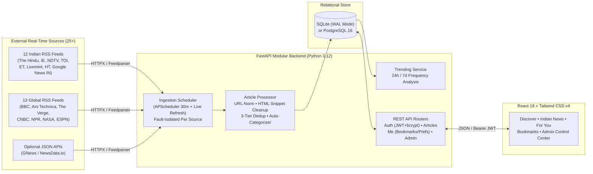

<div align="center">

# PULSE — News Discovery & Aggregation Platform

**A free, open-source web platform that unifies Global & Indian real-time news into one searchable, deduplicated, personalized feed.**

[](https://www.python.org/)
[](https://fastapi.tiangolo.com/)
[](https://react.dev/)
[](https://tailwindcss.com/)
[](https://www.sqlalchemy.org/)
[](#testing--verification)

*BTech Final Year Project • Full-Stack Engineering, Automated Ingestion, Deduplication & Editorial UI*

[Quick Start](#-quick-start) • [Architecture](#-system-architecture) • [Indian News](#-global--indian-real-time-sources) • [Live Demo Guide](#-mentor-demonstration-guide) • [API Reference](#-api-reference)

</div>

---

## 📌 Overview & Problem Statement

News and current-affairs coverage is fragmented across dozens of publisher websites. Readers following multiple subjects—Technology, Business, Politics, Science, and Sports—must repeatedly switch sources, encounter syndicated duplicates, and lose track of developing topics.

**PULSE** solves this at **zero operational cost** by aggregating **25 live RSS/Atom feeds** (and optional JSON News APIs) into a single, fast, searchable web application while strictly respecting publisher copyright:

- **No Full-Text Republication:** Stores only article metadata and sanitized RSS snippets (capped at 380 characters).
- **Clear Publisher Attribution:** Every card and detail drawer credits the source and links directly to the original publisher page.
- **Real-Time Global & Indian News:** Dedicated **Indian News** edition (`region=india`) alongside global coverage, with an on-demand **Refresh Live** trigger and a 30-minute background scheduler.

---

## 🎯 SRS Goals & Acceptance Alignment

| SRS Goal | Acceptance Measure | PULSE Implementation |
| :--- | :--- | :--- |
| **Centralized Discovery** | ≥ 10 configured RSS feeds in one feed | **25 live sources** (12 Indian + 13 Global) + optional GNews/NewsData.io APIs |
| **Useful Organization** | ≥ 5 core categories | **Technology, Business, Politics, Science, Sports** + Uncategorized fallback |
| **Findability** | Keyword search + category/date filters | Full search (`/` shortcut), region, category, publisher & date-range filters |
| **Less Repetition** | Identify and avoid duplicate entries | 3-tier deduplication (normalized URL, GUID, title similarity) + cross-source credit |
| **Personal Utility** | Bookmarks + preferred categories | JWT-authenticated **Bookmarks** & **For You** topic-prioritized home feed |
| **Freshness** | Scheduled checks + ingestion status | `APScheduler` 30-min interval + startup sync + Admin **Ingestion Logs** |

---

## 🏗 System Architecture

PULSE follows a modular 3-tier architecture separating feed ingestion, content processing, user APIs, and the React web client:



---

## ⚙️ How Core Features Work Under the Hood

### 1. Fault-Isolated Ingestion (`ingestion_scheduler.py`)
- Runs automatically on startup for any unfetched feeds, every **30 minutes** via `APScheduler`, and on demand via **Refresh Live** (`POST /api/articles/refresh`, 30s cooldown) or Admin **Sync All Feeds Now**.
- Every feed executes inside an isolated `try/except` and database transaction block—if one feed times out or serves malformed XML, the failure is recorded in `ingestion_runs` and the remaining sources proceed unaffected.

### 2. URL Normalization & 3-Tier Deduplication (`article_processor.py`)
- **URL Normalization:** Lowercases hosts, strips `www.`, removes `#fragments`, drops trailing slashes, and strips tracking parameters (`utm_*`, `fbclid`, `gclid`, `mc_cid`, etc.).
- **Duplicate Detection:** Matches incoming items by (1) `normalized_url`, (2) `source_id + external_id` (GUID), and (3) conservative `SequenceMatcher` headline similarity (`>= 0.86` after stripping trailing publisher suffixes like `- The Hindu`).
- **Source Attribution Retention:** When multiple publishers cover the same story, PULSE avoids duplicate cards and appends additional publishers to `also_seen_sources` (`+N sources` badge).

### 3. Smart Categorization & Frequency-Based Trends
- **Categorization Pipeline:** Feed metadata tags $\rightarrow$ multi-keyword rule scoring (requiring $\ge 2$ hits to override a feed's default category, preventing false positives like college team names in sports feeds) $\rightarrow$ feed default category $\rightarrow$ `Uncategorized` fallback.
- **Trending Topics:** Computes frequent capitalized phrases (e.g., *Supreme Court*, *Artificial Intelligence*), acronyms (*ISRO*, *RBI*, *AI*), and significant unigrams over `24h` / `7d` windows—dynamically scoped to **Trending in India** when the Indian News filter is active—with an explicit disclaimer that trends measure frequency rather than editorial importance.

---

## 🌍 Global & Indian Real-Time Sources

| Region | Pre-Configured Sources | Categories Covered |
| :--- | :--- | :--- |
| **🇮🇳 India (12 Feeds)** | The Hindu (National & Business), Indian Express (India & Tech), NDTV India, Times of India, Hindustan Times, Economic Times, Livemint, Google News India (Top, Sports, Science) | Politics, Business, Technology, Science, Sports |
| **🌐 Global (13 Feeds)** | Ars Technica, The Verge, BBC (Tech, Business, Politics, Science, Sport), CNBC, NPR (Business, Politics), NASA, ScienceDaily, ESPN | Technology, Business, Politics, Science, Sports |
| **🔌 Optional JSON APIs** | GNews India API, NewsData.io India API (enabled automatically when keys are set in `.env`) | All Indian Topics |

---

## 🛠 Technology Stack

- **Backend:** Python 3.12, FastAPI, SQLAlchemy 2.0, Pydantic v2, APScheduler, Feedparser, HTTPX, BeautifulSoup4
- **Security:** `bcrypt` one-way password hashing (`passlib`), signed HS256 JWT tokens (`PyJWT`), role-based access control (`reader` vs `admin`)
- **Database:** Zero-config SQLite (WAL mode) for instant local runs + PostgreSQL 16 (`psycopg`) via Docker Compose
- **Frontend:** React 18, Vite 6, Tailwind CSS v4 (with Dark Mode), Lucide Icons
- **Testing & Ops:** Pytest (`TestClient`), Docker & Docker Compose, Nginx reverse proxy

---

## 📂 Repository Structure

```text
pulse-news-aggregator/
├── backend/
│   ├── app/
│   │   ├── api/            # FastAPI routers (articles, discovery, auth, me, admin)
│   │   ├── core/           # Config, SQLAlchemy engine & migrations, JWT/bcrypt security
│   │   ├── models/         # 8 ORM entities (User, Category, FeedSource, Article, etc.)
│   │   ├── schemas/        # Pydantic request/response schemas
│   │   ├── services/       # Modular business services (8 SRS modules)
│   │   ├── seed.py         # Category rules, 25 feeds, and demo accounts
│   │   └── main.py         # App lifespan, startup sync & scheduler
│   ├── tests/              # Unit & integration tests (pytest)
│   ├── requirements.txt
│   └── Dockerfile
├── frontend/
│   ├── src/
│   │   ├── api/client.js   # Typed REST API wrapper
│   │   ├── components/     # Navbar, ArticleCard, ArticleDetailModal, TrendingSidebar,
│   │   │                   # AdminDashboard, AuthModal, PreferencesModal
│   │   └── App.jsx
│   ├── package.json
│   └── Dockerfile
├── docs/
│   ├── PULSE_Project_Report_and_Demo_Guide.pdf   # Full technical report & mentor demo script
│   └── PULSE_Presentation.pptx                   # 10-slide presentation deck with speaker notes
├── docker-compose.yml      # PostgreSQL 16 + FastAPI + Nginx React stack
├── .env.example
└── start-dev.ps1           # One-click Windows local launcher
```

---

## 🚀 Quick Start

### Option 1: One-Click Local Launch (Windows PowerShell)
First-time setup:
```powershell
# 1. Backend environment
cd backend
python -m venv .venv
.\.venv\Scripts\pip install -r requirements.txt

# 2. Frontend dependencies
cd ..\frontend
npm install
cd ..

# 3. Launch both backend & frontend together
.\start-dev.ps1
```
- **Web App:** `http://localhost:5173`
- **API & Swagger Docs:** `http://127.0.0.1:8000/docs`

### Option 2: Manual Setup (macOS / Linux / Windows)
```bash
# Terminal 1 — Backend
cd backend
python -m venv .venv
source .venv/bin/activate   # Windows: .\.venv\Scripts\Activate.ps1
pip install -r requirements.txt
uvicorn app.main:app --reload --port 8000

# Terminal 2 — Frontend
cd frontend
npm install
npm run dev
```

### Option 3: Docker Compose (PostgreSQL 16 + Backend + Frontend)
```bash
cp .env.example .env
# Update JWT_SECRET_KEY in .env before running in production
docker compose up --build
```
Access the production Nginx-served app at `http://localhost:8080`.

---

## 🎓 Mentor Demonstration Guide

Included in `docs/` are ready-to-present project materials:
- 📄 **[Technical Report & Mentor Demo Guide (PDF)](docs/PULSE_Project_Report_and_Demo_Guide.pdf)** — Architecture diagrams, pipeline walkthrough, 6-act live demo script, and Viva Q&A.
- 📊 **[Project Presentation Deck (PPTX)](docs/PULSE_Presentation.pptx)** — 10-slide widescreen deck with speaker notes.

### Demo Accounts (Available as 1-Click Buttons in the Sign-In Modal)

| Role | Email | Password | Capabilities |
| :--- | :--- | :--- | :--- |
| **Guest** | *(No login needed)* | — | Browse, search, Indian News filter, trending topics, live refresh |
| **Reader** | `reader@pulse.org` | `Reader@123` | Bookmarks, category preferences, personalized **For You** feed |
| **Administrator** | `admin@pulse.org` | `Admin@123` | Add/edit/disable feeds, sync feeds, view **Ingestion Logs**, edit keyword rules |

---

## 📡 API Reference

| Method & Endpoint | Access | Description |
| :--- | :--- | :--- |
| `GET /api/articles` | Public | Paginated articles (`page`, `size`, `region`, `category`, `source`, `from`, `to`, `q`, `prioritize_preferred`) |
| `POST /api/articles/refresh` | Public | Cooldown-guarded live sync across feeds (supports `region=india\|global`) |
| `GET /api/articles/{id}` | Public | Article metadata, cross-source attributions, and original publisher URL |
| `GET /api/categories` & `GET /api/sources` | Public | Categories (with article counts) and publishers (region-filterable) |
| `GET /api/trending` | Public | Frequency-based trending topics (`window=24h\|7d`, `region=india\|global\|all`) |
| `POST /api/auth/register` & `POST /api/auth/login` | Public | Register reader account & issue JWT bearer token |
| `GET / PUT /api/me/preferences` | Reader | Retrieve or update preferred categories |
| `GET / POST / DELETE /api/me/bookmarks` | Reader | List, add, or remove saved article bookmarks |
| `GET / POST / PATCH / DELETE /api/admin/feeds` | Admin | Manage RSS/Atom & API feed sources |
| `POST /api/admin/feeds/ingest` | Admin | Manually trigger ingestion for all feeds (or `/{id}/ingest` for one feed) |
| `GET /api/admin/ingestion-runs` | Admin | View recent fetch timestamps, counts, and error logs |

---

## ✅ Testing & Verification

Run the automated unit and API integration suite (isolated SQLite test DB + mock RSS/JSON payloads):

```powershell
backend\.venv\Scripts\python -m pytest backend\tests -v
```

- **8 / 8 Pytest tests passing:** URL normalization, HTML snippet sanitization, metadata/keyword categorization, 3-tier duplicate detection + attribution retention, fault-isolated feed failure logging, RBAC authorization, bookmarks/preferences, Indian news filtering, and JSON API normalizers.
- **Production Build:** Verified via `npm run build` in `frontend/`.
- **Live Verification:** Verified end-to-end against all 25 live Global & Indian feeds in the browser.
